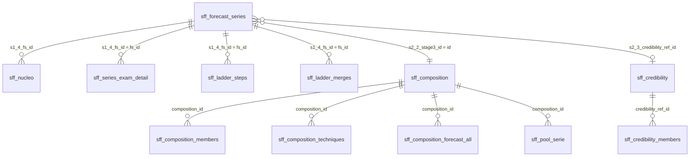

# El modelo de datos: hechos, dimensión de forecast series y satélites

## Principio

- **La forecast serie es la unidad con la que se habla con negocio.** Cada número del forecast es de una forecast serie: sus unidades que vencen, su tasa y su uplift.
- **Las 4 etapas de la escalera solo mejoran las condiciones de predicción.** El entrenamiento, el examen y la proyección se vuelven a referir a cada forecast serie.
- **Dos tablas centrales, un grano cada una:**
  - `sff_nucleo` es la **tabla de hechos**: una fila por registro (los originales y los sintéticos), con sus medidas y los valores propios de la fila;
  - `sff_forecast_series` es la **dimensión**: una fila por forecast serie, con todo lo de su nivel (etapas, composición, credibilidad, técnica, dinámica, examen y confianza).
- **Las tablas satélite son para el análisis en profundidad.** Se unen por sus claves y cada una se comprueba contra la tabla de la que sale (paso 8.2).
- **Nada se cuenta dos veces.** Un valor de la serie vive una sola vez, en la dimensión; por eso sus sumables se suman sin trucos.

## Los bloques y la numeración de los pasos (desde el 25-oct-2026, segunda versión)

El framework son **8 bloques funcionales**, cada uno en un módulo `block_<n>_<nombre>.py`, con una misión, lo que lee y lo que entrega. Sus pasos se numeran **relativos al bloque**: el bloque 4 tiene el paso 4.1, el bloque 7 los pasos 7.1, 7.2 y 7.3. El prefijo de una columna del núcleo es el paso que la crea, con guion bajo: `s<bloque>_<paso>_` (`s7_2_esperado_usd`). **Las columnas del núcleo y de la dimensión cambiaron de nombre otra vez.** Los nombres de las tablas `sff_*` no cambian.

| Bloque | Misión | Pasos |
|---|---|---|
| B1 preparación | el extracto verificado, en las tablas de las que parte toda predicción | 1.1–1.7 |
| B2 tasa | la tasa de renovación de cualquier fila, a cualquier horizonte, con su banda | 2.1–2.7 |
| B3 precio | el uplift (revalorización) de quien renueva y la vía que mejor lo predice | 3.1–3.3 |
| B4 estados del cliente | cuántas unidades llevarán cada estado al vencer | 4.1 |
| B5 pipeline futura | las filas que el extracto aún no tiene: renovaciones proyectadas y captación simulada | 5.1 |
| B6 time series | el universo de retail a suscripción, por regiones | 6.1 |
| B7 examen y montaje | el examen (la banda), el forecast en dinero y el total | 7.1–7.3 |
| B8 salida y control | núcleo, auditoría, Power BI, validación e informe, sin cambiar ningún número | 8.1–8.6 |

**Equivalencias** (número que tenía cada paso hasta este cambio → ahora; prefijo de columna):

| Antes | Ahora | Paso | Prefijo |
|---|---|---|---|
| 00 | 1.1 | validar el extracto | `s00_` → `s1_1_` |
| 01 | 1.2 | valores y niveles | — |
| 02 | 1.3 | calendario | `s02_` → `s1_3_` |
| 03 | 1.4 | tabla fina | `s03_` → `s1_4_` (`s1_4_fs_id`, `s1_4_fu_id`, `s1_4_uplift_cell_id`) |
| 04 | 1.5 | forecast units | `s04_` → `s1_5_` |
| 05 | 1.6 | series y rutas | `s05_` → `s1_6_` |
| 06 | 1.7 | series de tasa | `s06_` → `s1_7_` |
| 07 | 2.1 | dimensiones | — |
| 08 | 2.2 | grupos de la escalera | `s08_` → `s2_2_` |
| 09 | 2.3 | credibilidad | `s09_` → `s2_3_` |
| 10 | 2.4 | serie de composición | — |
| 11 | 2.5 | dinámica | `s11_` → `s2_5_` |
| 12 | 2.6 | backtest de la tasa | `s12_` → `s2_6_` |
| 13 | 2.7 | caja de la tasa | — |
| 14 | 3.1 | uplift | `s14_` → `s3_1_` |
| 15 | 3.2 | diagnósticos del precio | — |
| 16 | 3.3 | backtest del uplift | — |
| 17 | 4.1 | estados del cliente | — |
| 18 | 5.1 | pipeline futura | — |
| (dentro del 18) | 6.1 | universo time series | — |
| 19 | 7.1 | examen de cada serie | `s19_` → `s7_1_` |
| 20 | 7.2 | forecast | `s20_` → `s7_2_` |
| 21 | 7.3 | total | — |
| 22 | 8.1 | filas nuevas | — |
| 23 | 8.2 | auditoría | — |
| 24 | 8.3 | núcleo | — |
| 25 | 8.4 | Power BI | — |
| 26 | 8.5 | validación | — |
| 27 | 8.6 | informe | — |

**Bloque 1, persistido** (`persist_block()`): tablas de trabajo para reanudarlo, no para Power BI:

| Tabla | Qué guarda |
|---|---|
| `sff_bloque1_filas_time_series` | el universo time_series (paso 1.2) |
| `sff_bloque1_tabla_fina` | cada fila con sus ids (paso 1.4); `__indice__` es el id de la fila |
| `sff_bloque1_forecast_units` | una fila por serie y mes (paso 1.5) |
| `sff_bloque1_series` | una fila por serie con su ruta (paso 1.6) |
| `sff_bloque1_units_con_tasa` | las units con los huecos y la tasa de cada una (paso 1.7) |
| `sff_bloque1_series_tasa` | soporte, tasa propia, error y signo de cada serie (paso 1.7) |
| `sff_bloque1_manifiesto` | cada columna de esas tablas y su tipo, para devolvérselo al leerla |
| `sff_bloque1_huella` | con qué se construyó: filas y USD del extracto, mes en curso y los campos de la Config que lee el bloque |

## Las relaciones del modelo de Power BI (`sff_relaciones_modelo`, paso 8.4)

Las relaciones están declaradas en el código (`MODEL_RELATIONS`, paso 8.4) y se comprueban en cada ejecución sobre las tablas que escribe: las columnas existen, la clave del lado 1 es única y cada fila del lado n encuentra su clave (si no, en Power BI queda en blanco: aviso). La tabla `sff_relaciones_modelo` dice, para cada relación, las filas de cada lado, si la clave es única y cuántas filas del lado n no encuentran clave.

| Lado 1 | Clave | Lado n | Columna | Para qué |
|---|---|---|---|---|
| `sff_forecast_series` | `s1_4_fs_id` | `sff_nucleo` | `s1_4_fs_id` | la serie filtra sus filas |
| `sff_forecast_pipeline_source` | `forecast_pipeline_source` | `sff_nucleo` | `forecast_pipeline_source` | la etiqueta de negocio de cada origen |
| `sff_uplift_celda` | `uplift_cell_id` | `sff_nucleo` | `s1_4_uplift_cell_id` | el uplift de la celda de cada fila |
| `sff_forecast_series` | `s1_4_fs_id` | `sff_series_exam`, `sff_series_exam_detail`, `sff_ladder_steps`, `sff_ladder_merges`, `sff_series_dynamics` | `fs_id` | el examen, la escalera y la dinámica de la serie |
| `sff_composition` | `composition_id` | `sff_forecast_series` | `s2_2_stage3_id` | la composición de cada serie (las que no suben la escalera quedan sin ella: aviso esperado) |
| `sff_composition` | `composition_id` | `sff_composition_members`, `sff_pool_serie`, `sff_composition_techniques`, `sff_composition_forecast_all` | `composition_id` | quién la forma, su serie mensual, sus técnicas y la tasa futura de cada una |
| `sff_credibility` | `credibility_ref_id` | `sff_forecast_series`, `sff_credibility_members` | `s2_3_credibility_ref_id`, `credibility_ref_id` | la referencia de credibilidad y quién entra en su tasa |


## El diagrama



## La tabla de hechos: `sff_nucleo`

Una fila por registro: las filas del extracto, los huecos (meses sin vencimientos), las filas proyectadas y simuladas del horizonte, y las del universo time_series.

| Bloque | Columnas | Qué dice |
|---|---|---|
| Dimensiones y mes | las del extracto, `period` | el grano fino |
| Medidas | `s00_*`, `s02_*` | lo que vence y renueva, antes y después del calendario |
| Ids | `s1_4_fs_id`, `s1_4_fu_id`, `s1_4_uplift_cell_id` | la forecast serie (clave de la dimensión), la unidad y la celda de precio |
| Unidad | `s1_5_filas_finas` | el detalle de la forecast unit |
| Forecast | `s20_*`, `s7_2_confidence` | tasa, banda, uplift, esperado y confianza de cada fila futura |
| Final | `forecast_*` | lo que se suma para responder: renovado real y previsto, pipeline, por año y origen |
| Final, maduración de los estados del cliente (etapa 4.1) | `forecast_to_renew_units_at_due`, `forecast_to_renew_USD_at_due`, `forecast_maturation_units`, `forecast_renewed_units_maturation_adj`, `forecast_renewed_USD_maturation_adj` | el dato no cambia: `forecast_to_renew_*` es la pipeline de hoy. La caja de la etapa 4.1 (`block_4_customer_states.py (paso 4.1)`, `StateMaturation`) predice cuántas unidades de cada grupo (la serie sin sus estados) y mes llevarán cada combinación de estados del cliente al vencer; `forecast_to_renew_*_at_due` es la pipeline al vencer (mismo total, movida de la serie neutra a las con estado) y `forecast_maturation_units` la diferencia (− en la neutra, + en la con estado). Lo que sale de una fila neutra sale a su precio medio; lo que llega a una serie con estado es una FILA DE PREDICCIÓN (`origen_fila = maduracion`, sin dato: `s00_*` y `forecast_to_renew_*` a 0) que renueva a la tasa y el uplift de esa serie. `forecast_renewed_USD − forecast_renewed_USD_maturation_adj` = el forecast con los estados de hoy (también en `s7_2_esperado_usd_hoy`). Se maduran también las filas proyectadas y simuladas (sin columnas de fecha: la proporción histórica final). Tabla `sff_forecast_maduracion`: mes a mes, cada estado hoy, esperado y final (la que apuntó la caja), tasa base y final, ajuste y los dos vasos |
| Final, base exacta del uplift | `forecast_to_renew_USD_renewed` (de `renewed_pipeline_usd_col`) | el USD que vencía de los contratos que RENOVARON (construido licencia a licencia). Con él, uplift = Σ renovado USD / Σ esta columna: revalorización pura, condicionada a renovar. Solo en meses cerrados del extracto |
| Final, renovaciones isolated | `forecast_isolated_to_renew_units`, `forecast_isolated_renewed_units`, `forecast_isolated_renewed_USD`, `forecast_isolated_to_renew_USD_renewed` (de `isolated_pipeline_units_col`, `isolated_renewed_units_col`, `isolated_renewed_usd_col`, `isolated_renewed_pipeline_usd_col`) | las renovaciones del proceso normal, aisladas de cualquier evento de retención (en Kamelot: los contratos que nunca tuvieron softcancel, antes, durante ni después de la renovación). Nombres fijos del framework, se llamen como se llamen en el extracto. Solo en meses cerrados: la referencia para ver una subida de precio sin descuentos de retención |
| Final, dispersión de las isolated | `forecast_isolated_renewed_USD_sq_over_tr` (de `isolated_renewed_usd_sq_over_tr_col`) y `forecast_isolated_to_renew_USD_renewed_<tramo>` para lt095, 095_100, 100_105, 105_110, 110_120, ge120 (de `isolated_tr_usd_renewed_<tramo>_col`) | construidas licencia a licencia con ratio = USD renovado / lo que valía, y sumadas. El momento (Σ renovado² / lo que valía) da, con la base y el renovado isolated, la desviación típica exacta ponderada de cualquier grupo; los seis tramos reparten la base por ratio y suman exactamente la base isolated (el paso 1.2 lo comprueba) |

## Los parámetros de la ejecución: `sff_parametros` (paso 8.4)

Una fila por campo de la Config: `valor` en esta ejecución, `por_defecto`, `cambiado` (1 si la ejecución lo fija), `pasos` (los pasos cuyo código lo lee, calculado leyendo el código: CFG = la propia Config, ORQ = el orquestador; el resto, el número de la etapa), `pasos_documentados` (la etiqueta [..] de su comentario en config.py; un test exige que coincidan) y `descripcion`. Todo número que decide algo está en la Config; fuera solo quedan definiciones (100 pp, 12 meses al año, la varianza binomial máxima, las ventanas que dan nombre a una técnica). Al arrancar, el orquestador lista los parámetros con valor propio de la ejecución.

## Tablas del uplift y del monitor de precios

- `sff_uplift_homogeneidad` (paso 3.2, los diagnósticos del precio; solo con la base exacta): una fila por celda de uplift con renovadores. `ratio_seleccion` = precio medio que vencía de los renovadores / precio medio de la celda: a 1, los renovadores valían la media y la aproximación antigua era exacta; por encima, renuevan más los caros y la aproximación inflaba el uplift en ese ratio (`uplift_aproximado = uplift_exacto × ratio_seleccion`). Donde se aleja de 1, la celda mezcla precios: la respuesta es segmentar mejor, no añadir un factor al forecast.
- `sff_price_increase_monitor` (paso 8.4): una fila por **grupo de precio** (`price_group_dims`: región en sus tres niveles × producto level_1, porque las tarifas cambian así) y mes cerrado de pipeline; con `renewed_USD` y `uplift_base_USD` para sumar grupos en Power BI, y el detector solo en meses con ≥ `price_group_min_renewed_units` renovaciones.
- `sff_price_increase_calendar` (paso 8.4): una fila por subida detectada: grupo, mes de inicio, escalón, uplift antes y durante el ciclo, USD renovado que tocó. Para contrastarlo con el calendario real de tarifas.
- El uplift de `sff_uplift_celda` (paso 3.1) es el de la **ventana reciente** (`uplift_window_months`, 12 por defecto) **sin las subidas** detectadas (`uplift_without_increases`): los meses de la ventana dentro del ciclo de una subida de su grupo se deflactan por ella. En el núcleo (`s7_2_factor_subida`), `factor_subida` es el factor con que cada fila futura la recupera mientras su mes sigue dentro del ciclo (1 fuera de él, y en la vía contrato); el uplift de la fila ya lo lleva. El detector (`price_increases.py`) es el mismo para los pasos 3.1, 3.3 y 8.4.
- `s3_1_origen_uplift` (núcleo, 25-oct-2026) dice de dónde sale el uplift de cada fila futura:
  - `celda`: su fila de `sff_uplift_celda`;
  - `celda_mandatory` o `global`: una fila extendida con una celda que nunca se vio. Queda en blanco en la relación con `sff_uplift_celda`; es el aviso 11 del 8.4;
  - `contrato`;
  - `varias`: una fila agregada de la maduración.
- (antes) el monitor era una fila por mes de toda la cartera. El uplift de todos y el de las renovaciones isolated (el detector: sin descuentos de retención), la media de los 12 meses anteriores, el escalón frente a ella, `above_threshold` (escalón ≥ 3 %), `price_increase_flag` (primer mes de una racha de ≥ 3 meses seguidos por encima: un mes suelto es ruido, no una subida), `in_increase_cycle` y `months_since_increase`. El uplift isolated usa su base exacta (`forecast_isolated_to_renew_USD_renewed`) cuando está; con la dispersión, además `desv_isolated`, `share_isolated_near_100` ([0,95, 1,05)) y `share_isolated_ge110`. Cada métrica del monitor necesita solo sus columnas. Una subida afecta a las renovaciones de UN ciclo (quien renueva paga la tarifa nueva contra la vieja; un año después todo lo que vence ya compró a la nueva), así que el ciclo dura 12 meses y se apaga.

## La dimensión: `sff_forecast_series`

Una fila por forecast serie. Es la tabla que se filtra en Power BI.

| Bloque | Columnas | Qué dice |
|---|---|---|
| Ruta y tasa propia | `s05_*`, `s1_7_n_propio`, `s1_7_tasa_propia`, `s1_7_error_binomial_pp`, `s1_7_signo` | la serie sola: su soporte, su tasa y el error de un mes |
| Etapas 0-3 | `s2_2_stage0_id` … `s2_2_stage3_id` con su `_support` | cuánto soporte gana en cada etapa; `stage3` es su **composición** |
| Etapa 4 · credibilidad | `s2_3_composition_series`, `s2_3_composition_rate`, `s2_3_credibility_ref_id`, `s2_3_k`, `s2_3_z`, `s2_3_tasa_estimada`, `s2_3_credibility_effect_pp`, `s2_3_se_prediccion_pp`, `s2_3_nivel_riesgo` | cuánto se fía de su composición, cuánto mueve la tasa la referencia, y el error de la predicción |
| Dinámica de su composición | `s2_5_phi`, `s2_5_tendencia`, `s2_5_estacional`… | φ, tendencia y estacionalidad de la composición |
| Técnica | `s2_6_tecnica_<tramo>`, `s2_6_examen_err_pp_<tramo>`… | la técnica elegida por tramo y su error en el examen |
| Dinámica propia | `s2_5_series_phi`, `s2_5_series_trend`, `s2_5_series_seasonal`, `s2_5_series_measurable`, `s2_5_series_differs` | la de la propia serie, para cruzarla con la precisión |
| Examen, ratios | `s7_1_exam_mae_pp`, `s7_1_exam_bias_pp`, `s7_1_exam_wape`, `s7_1_exam_coverage`, `s7_1_raw_mae_pp`, `s7_1_raw_coverage`, `s7_1_improvement_mae_pp` | cuánto acertó el framework, cuánto la serie sola (raw) y la diferencia |
| Examen frente al ruido | `s7_1_exam_rmse_pp`, `s7_1_exam_noise_pp`, `s7_1_exam_error_over_noise`, `s7_1_raw_error_over_noise` | el error frente al ruido binomial de su tasa: ≈ 1 es el límite (la regla del ruido) |
| Examen, sumables | `s7_1_exam_predictions`, `s7_1_exam_in_band`, `s7_1_exam_pred_units`, `s7_1_exam_real_units`, `s7_1_exam_abs_err_units`, `s7_1_raw_predictions`, `s7_1_raw_in_band`, `s7_1_raw_real_units`, `s7_1_raw_abs_err_units` | para sumar el acierto sobre cualquier filtro |
| Dinero y confianza | `s7_2_esperado_usd_total`, `s7_2_pct_usd_high` / `_medium` / `_low`, `s7_2_confidence` | lo que se espera renovar y con qué confianza (la de la mayor parte de su dinero) |

`sff_nucleo_leyenda` describe las columnas de las dos tablas: la columna `tabla` dice a cuál pertenece cada una, y `como_agregar` cómo sumarla.

## Ver la mejora frente al raw (Power BI)

**Relación:** `sff_forecast_series[s1_4_fs_id]` 1 → n `sff_nucleo[s1_4_fs_id]`, en una sola dirección. Al filtrar una o varias forecast series en la dimensión, se filtran sus filas.

**Gráficos para una forecast serie seleccionada,** sobre tablas relacionadas por `fs_id`:

| Gráfico | Datos |
|---|---|
| Soporte por etapa (raw → composición) | `s2_2_stage0_support` … `s2_2_stage3_support` de la dimensión |
| Error del raw frente al de la estimación | `s1_7_error_binomial_pp` frente a `s2_3_se_prediccion_pp` |
| Examen mes a mes: real, baseline, raw, por_defecto y framework, con el intervalo y en USD | `sff_series_exam_detail` (una fila por mes × horizonte × método) |
| Cómo se formó su composición | `sff_ladder_steps` y `sff_ladder_merges` (sesgo, error sola y junta) |
| Quién entra en la tasa de su composición | `sff_composition_members` (`uses` / `lends`) |

**Medidas sobre cualquier filtro:**

| Medida | DAX |
|---|---|
| Examen: dentro del intervalo (framework) | `DIVIDE(SUM(sff_forecast_series[s7_1_exam_in_band]), SUM(sff_forecast_series[s7_1_exam_predictions]))` |
| Examen: dentro del intervalo (raw) | `DIVIDE(SUM(sff_forecast_series[s7_1_raw_in_band]), SUM(sff_forecast_series[s7_1_raw_predictions]))` |
| WAPE framework | `DIVIDE(SUM(sff_forecast_series[s7_1_exam_abs_err_units]), SUM(sff_forecast_series[s7_1_exam_real_units]))` |
| WAPE raw | `DIVIDE(SUM(sff_forecast_series[s7_1_raw_abs_err_units]), SUM(sff_forecast_series[s7_1_raw_real_units]))` |
| Sesgo del total (framework) | `DIVIDE(SUM(sff_forecast_series[s7_1_exam_pred_units]), SUM(sff_forecast_series[s7_1_exam_real_units])) - 1` |
| Renovado (real + previsto) | `SUM(sff_nucleo[forecast_renewed_USD])`, segmentado por `forecast_year`, `forecast_status`, `forecast_pipeline_source` |
| Tasa de renovación (meses cerrados) | `DIVIDE(SUM(sff_nucleo[s1_3_renovadas_unidades]), SUM(sff_nucleo[s1_1_vencen_unidades]))` con `s1_3_rol` en entrenamiento y examen |

Para cruzar el acierto con la dinámica se segmenta por `s2_5_series_*` (por ejemplo, volatilidad alta frente a baja). El informe trae esa tabla en el capítulo 5.

## Las tablas auxiliares de Power BI (paso 8.4)

El paso 8.4 construye en Python el contexto que el informe necesita (nombres de negocio, orden, bloques), para que
Power BI solo relacione y sume, sin lógica dentro del informe.

| Tabla | Una fila por | Relación | Columnas |
|---|---|---|---|
| `sff_forecast_pipeline_source` | origen de la pipeline | `[forecast_pipeline_source]` 1 → n `sff_nucleo[forecast_pipeline_source]` | `source_label`, `source_block`, `source_order` (ordenar la etiqueta por esta columna) |

## Las satélites

| Tabla | Una fila por | Clave | Para qué |
|---|---|---|---|
| `sff_series_exam_detail` | forecast serie × mes de examen × horizonte × método | `fs_id` | cada predicción del examen (baseline, raw, por_defecto, framework), trazada: tasa de la composición, desplazamiento por credibilidad, tasa, intervalo, real, error y su ruido binomial (`noise_pp`); y en USD (`pred_usd`, `real_usd`, `err_usd`: unidades × el precio de sus renovaciones reales, el mismo para todos los métodos) |
| `sff_series_exam` | forecast serie | `fs_id` | el examen resumido por método, raw y framework lado a lado (la dimensión lo lleva) |
| `sff_ladder_steps` | forecast serie × pasada | `fs_id` | su id en cada pasada, el soporte de su grupo y si ya tiene composición |
| `sff_ladder_merges` | forecast serie × fusión | `fs_id` | grupo antes y después, sesgo, error sola y junta, y si la fusión mejora |
| `sff_composition_members` | composición × forecast serie | `composition_id` | todas las series de su tasa: `uses` (predice con ella) o `lends` (solo presta su historia) |
| `sff_composition` | id de cualquier etapa | `s2_2_stageN_id` | quién lo forma, soporte, tasa; si es composición, cómo se predice |
| `sff_composition_techniques` | composición × tramo × técnica | `composition_id` | estado (`tested` / `not_enough_history` / `composition_below_floor`), errores, ranking, elegida |
| `sff_composition_forecast_all` | composición × horizonte futuro × técnica | `composition_id` | la tasa futura que daría cada técnica, no solo la elegida |
| `sff_pool_serie` | composición × mes | `composition_id` | la serie mensual de la composición (suma de todas las series de su tasa) |
| `sff_credibility` | referencia de credibilidad | `s2_3_credibility_ref_id` | soporte, tasa, k y sus partes |
| `sff_credibility_members` | referencia × forecast serie | `credibility_ref_id` | qué series entran en la tasa de la referencia: `borrower` (se apoya en ella) o `lender` (solo aporta datos) |
| `sff_series_dynamics` | forecast serie | `fs_id` | φ, tendencia y estacionalidad de la propia serie, y si son medibles |
| `sff_bandas_reales` y `sff_bandas_reales_resumen` (las escribe `informe_forecast.py`, preguntas 6.1 y 6.2) | nivel × grupo × mes (o `acumulado`) × h; y nivel × base × h × regla | — (tablas sueltas) | el error real del examen del 7.1 sumado a cada nivel (serie, composición, subregión, región, total) frente a la semibanda de cada regla de suma (lineal, composición, cuadratura, binomial), y su resumen: cobertura, cociente error/banda, error medio y parte de sesgo. Para decidir con datos reales cómo se suman las bandas |
| `sff_curva_maduracion` (paso 7.2, desde el 26-oct-2026) | estado con fechas × k (meses antes de vencer, 12 = «12 o más») | — (tabla suelta) | la curva de maduración del paso 4.1: `parte_que_entra` (f(k), la distribución de cuándo se pone el estado final), `parte_visible` (F(k)), `p_entrar` (p(k), lo que usa el forecast), `tope`, `se_usa` (0 si la curva suspendió su examen) y el examen por antelación (`error_curva_pp`, `error_sin_curva_pp`, en blanco donde no se examinó). La lee la pregunta 2.1 de `informe_forecast.py` |
| `sff_ts_examen` (paso 6.1) | candidato (regla del nivel × ventana del valor por unidad) × horizonte | — (tabla suelta) | el examen de la simulación time series: error medio del total del mes a cada horizonte con cada candidato (`candidato`, `regla_nivel`: `region`, `credibilidad`, `total`, `sin_nivel`; `ventana_valor_medio`: 1, 3 o 12 meses), su error medio y el candidato elegido (`elegida = 1`), que es el que simula y da la banda. Desde el 26-oct-2026 la ventana del valor por unidad también la elige el examen (antes, 12 meses fijos) |

## El forecast contado: `informe_forecast.py` (desde el 26-oct-2026)

El script cuenta el forecast pregunta a pregunta sobre las tablas de una ejecución, sin volver a ejecutar nada. Cada pregunta tiene una SQL (SQL Server; también corre en el SQLite de los sintéticos), su CSV y uno o más gráficos. Todo va a `salida/informe/`, o a `salida/informe_<base>/` con los sintéticos.

Los capítulos:

1. el dato real;
2. lo que se simula para construir;
3. la pipeline construida del año que viene;
4. el resultado de los dos años;
5. cómo desgranarlo.

Uso: `report(configuration)`, `report(configuration, ["3.1"])` o `python informe_forecast.py parecido 2026-10`.

La banda que se puede desagregar (`composition_band_query`) se calcula así:

- las filas de una composición (`s2_2_stage3_id`, la misma tasa) se mueven juntas;
- composiciones distintas se mueven por separado;
- el error del volumen de la adquisición simulada (`s7_2_error_captacion_usd`, nueva columna del núcleo) mueve todas las adquisiciones a la vez.

Con ello, la semibanda es √(Σ por composición (Σ desviaciones)² + (Σ error de adquisición)²). La de una región se calcula en la región, nunca sumando las de sus subregiones. La suma de las bandas de las filas es el peor caso. El test `test_informe_forecast.py` comprueba que la banda por composición es la misma calculada en pandas y que queda entre las filas independientes y la banda lineal.

## El veredicto y el perfil de la ejecución (paso 8.6, desde el 25-oct-2026)

Cada bloque cierra con su **veredicto** (`verdicts.py`): las hipótesis en que descansa, contrastadas con los datos de la ejecución. Son tablas sueltas, sin relación con el núcleo: se leen como página de Power BI.

| Tabla | Una fila por | Columnas | Para qué |
|---|---|---|---|
| `sff_veredicto_bloques` | bloque × pregunta | `bloque`, `paso`, `tipo` (hipótesis · examen · dato · aviso), `pregunta`, `metrica`, `valor`, `referencia`, `veredicto` (se cumple · no se cumple · no concluyente · dato · revisar), `detalle` | qué hipótesis del framework se sostienen con estos datos, con su número y la referencia contra la que se mide |
| `sff_perfil_datos` | sección × dimensión × valor | `seccion` (cartera · mes · dimension · concentracion · soporte · historia), `dimension`, `valor`, `orden`, `series`, `unidades_vencen`, `usd_vence`, `unidades_renovadas`, `usd_renovado`, `tasa_unidades`, `tasa_usd`, `usd_vence_12m_anteriores`, `crecimiento_anual`, `usd_vence_futuro`, `cuota_usd_futuro`, `cuota_futuro_con_soporte` | el perfil de la pipeline: volumen, distribución por dimensión, concentración, soporte e historia del dinero a predecir. Las cifras cerradas son de los últimos 12 meses cerrados; las futuras, desde el mes en curso |

`sff_resumen_negocio` (paso 7.2, una fila por año) lleva además de qué está hecha la banda oficial:
- `banda_tasa_usd`;
- `banda_precio_usd`;
- `banda_tasa_y_precio_usd` (tasa y precio en cuadratura, mes a mes);
- `banda_captacion_usd`;
- `banda_time_series_usd`.

Las tres últimas suman `error_examen_usd`.

## Los informes agregados no son tablas

Un informe con pocas filas porque está muy agregado se reproduce con una consulta sobre las tablas de detalle. El paso
que lo calcula imprime esa consulta (`report_queries.py`), y los tests comprueban que da el mismo resultado:

- las filas que el framework añade o borra (paso 8.1): no se escribe, desde `sff_nucleo`;
- el calendario por rol y por mes (paso 1.3), desde `sff_nucleo`;
- el examen por método y horizonte, y por mes (paso 7.1), desde `sff_series_exam_detail`;
- el total por año y origen (paso 7.3), desde `sff_nucleo`.

`sff_examen_cartera(_resumen)` y `sff_forecast_total` todavía se escriben, aunque tengan su consulta (el explorador las lee).

## Lo que NO se escribe (20-oct-2026)

Se calcula en memoria y llega a `sff_nucleo`, a `sff_forecast_series` o al informe, pero no es una tabla SQL propia:
nadie la leía y no está en el modelo de Power BI. Si al pintar el Power BI completo hace falta alguna, se vuelve a
escribir.

- **Pasos quitados:** el 05 (lookups id ↔ clave hash: el núcleo y Power BI unen por el id en texto) y el 07 (cota de
  soporte por unidad: nadie comparaba contra ella). Con ellos, las claves hash (`fs_key`, `fu_key`, `uplift_cell_key`,
  `fila_key`) y la columna `universo` (siempre `normal` desde que el paso 1.2 separa el time_series).
- **Tablas que ya no se escriben:** `sff_fact_fine` y `sff_fact_fu` (03, 04), `sff_calendario` (02),
  `sff_dimension_levels` y `sff_dimension_level_values` (01: el JSON de niveles es el registro), `sff_series` (06),
  `sff_fu_huecos` y `sff_series_tasa` (08), `sff_decision_eta2_pares` (09, quitada del todo), `sff_ladder_groups` (10),
  `sff_series_estimacion` (11), `sff_composition_dynamics` y `sff_estacionalidad_cartera` (13), `sff_dim_tecnica` (14),
  `sff_forecast` (17), `sff_time_series` (20), `sff_ficha_serie` (informe, quitada del todo).
- **Del paso 8.2:** `sff_series_backtest` y `sff_series_technique_summary`. Repetían el examen de cada serie que ya hace
  el paso 7.1 (`sff_series_exam`, `sff_series_exam_detail`); su único control era comprobar que coincidían.

## Las sumas de comprobación

**Núcleo (paso 8.3):**
1. Cada registro original y cada fila sintética aparece una vez.
2. El dinero concilia con el extracto.
3. Cada fila tiene los valores de cada bloque presente.
4. La leyenda describe cada columna.
5. El núcleo sumado por año y origen es `sff_forecast_total`.
6. La dimensión tiene una fila por forecast serie del núcleo.
7. Los sumables del examen en la dimensión son los del paso 7.1 (cada serie una vez).

**Examen (paso 7.1):**
1. Ninguna predicción usa un mes posterior a su origen (T − h).
2. Los tres métodos predicen exactamente las mismas filas.
3. Las renovaciones reales del examen son las de los meses de examen.
4. El resumen por serie suma el detalle.

**Auditoría (paso 8.2):**
1. Cada etapa es un reparto: las unidades que vencen de sus ids suman las del raw.
2. Cada etapa contiene cada forecast serie estimable una sola vez.
3. Cada composición y tramo tiene una técnica elegida, la del paso 2.6.
4. Soporte, tasa y series de cada referencia, recalculados desde sus miembros, son los usados.
5. Hay una fila de dinámica por forecast serie estimable.
6. Cada composición es la suma de todas las series de su tasa (las que la usan y las que prestan) en cada mes de examen.
7. Sin credibilidad, cada serie predice exactamente la tasa de su composición.
8. Cada forecast serie y tramo tiene una técnica elegida en su resumen.
9. La técnica elegida da la tasa que usó el forecast.
10. La técnica elegida, aplicada a cada serie, da la misma predicción que el framework del paso 7.1: hay una sola forma de predecir (`prediction.py`).

## Cómo auditar una forecast serie

1. **En la dimensión:** su ruta, su soporte propio y el de su composición, su nivel de riesgo, su confianza, y el examen raw frente a framework.
2. **En el núcleo:** sus filas, su renovado previsto y su banda (`s20_*`, `forecast_*`).
3. **Cómo se formó su composición:** `sff_ladder_steps` (pasada a pasada) y `sff_ladder_merges` (si cada fusión mejoró).
4. **Su composición** (`s2_2_stage3_id` → `sff_composition` y `sff_composition_members`): quién entra en su tasa y quién la usa.
5. **Las técnicas** (`sff_composition_techniques`, `sff_composition_forecast_all`): las probadas, las descartadas y por qué, y lo que habría dado cada una.
6. **La credibilidad** (`s2_3_credibility_ref_id` → `sff_credibility` y sus miembros): cuánto pesa la referencia y por qué ese k.
7. **El examen** (`sff_series_exam_detail`): cada predicción, mes a mes, de los cuatro métodos, con su intervalo y en USD.
8. **Su dinámica** (`sff_series_dynamics`): si tiene tendencia o estacionalidad propia, y si es medible.

## El explorador en el notebook (`sff_explorer.py`)

Un panel interactivo que lee las tablas de una ejecución y no recalcula nada: cada número es el que la ejecución escribió.

```python
from sff_explorer import SFFExplorer
explorer = SFFExplorer.from_results(results, configuration)   # results = run(configuration), en memoria
# o, en otra sesión, sin volver a ejecutar: lee las tablas sff_* (del núcleo solo las columnas que usa)
explorer = SFFExplorer.from_sql(configuration)
explorer.show()                                                # nueve pestañas, cada una se construye al abrirla
explorer.export_html("salida/sff_explorador.html", top_series=10)   # todo en un HTML para abrir en el navegador o enviar
explorer.show_page("ficha", fs_id="...")                       # una página estática, sin widgets
```

| Pestaña | Responde | Tablas |
|---|---|---|
| 1 · Negocio | cómo acaba el año en curso, qué pipeline vence el siguiente y de dónde sale, cómo acaba el siguiente; mes a mes; desglose por cualquier dimensión y año | `sff_resumen_negocio`, `sff_forecast_total`, `sff_forecast_mes`, `sff_nucleo` |
| 2 · Forecast series | dónde está el dinero, con qué confianza y cuánto se equivocó cada serie; por nivel de riesgo | `sff_forecast_series` |
| 3 · Ficha de serie | las siete preguntas de una serie: historia, examen, técnicas, dinero, escalera, composición, filas futuras | `sff_nucleo`, `sff_series_exam_detail`, `sff_composition_techniques`, `sff_ladder_steps`, `sff_ladder_merges`, `sff_composition_members`, `sff_pool_serie`, `sff_series_dynamics` |
| 4 · Escalera | cómo se mejoró el soporte: paso a paso, por etapa, cada fusión y si mejoró, el orden de colapso, cualquier composición | `sff_ladder_summary`, `sff_forecast_series`, `sff_niveles_riesgo`, `sff_ladder_merges`, `sff_decision_eta2`, `sff_composition` |
| 5 · Backtest y técnica | qué técnica predice cuánto dinero y por qué ganó; elegida frente a la técnica por defecto; error del total por mes; bandas; el backtest de cualquier composición | `sff_decision_tecnica`, `sff_backtest_examen`, `sff_backtest_examen_total`, `sff_decision_bandas`, `sff_backtest_predicciones` |
| 6 · Examen | de la baseline al framework en los mismos meses; error frente al ruido; si la etiqueta de confianza dice la verdad | `sff_examen_cartera(_resumen)`, `sff_series_exam`, `sff_forecast_series` |
| 7 · Uplift y precios | el uplift por origen, su examen, la regla de contrato, la homogeneidad, las subidas en juego y el monitor de cada grupo de precio | `sff_uplift_celda`, `sff_backtest_uplift`, `sff_uplift_contrato_check`, `sff_uplift_homogeneidad`, `sff_price_increase_monitor`, `sff_price_increase_calendar` |
| 8 · Estados del cliente | cada estado hoy, esperado y final, y lo que la maduración (etapa 4.1) resta al forecast | `sff_forecast_maduracion` |
| 9 · Parámetros y validación | la validación final, los parámetros de la ejecución y la leyenda de cualquier columna | `sff_validacion`, `sff_parametros`, `sff_nucleo_leyenda` |

Si los gráficos no aparecen dentro de las pestañas (depende del entorno del notebook), `figure_mode="html"` los dibuja como HTML. Requisitos: pandas, plotly e ipywidgets. El test `test_explorer.py` construye todas las páginas, con cada valor de sus controles, desde memoria y desde SQL, y comprueba que dan los mismos números.
